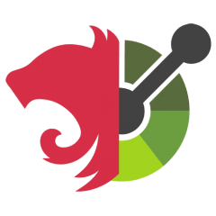

<p align="center">
  
</p>

<h1 align="center">@nest-openapi/mcp</h1>

<p align="center"><strong>Spec-driven MCP server for exposing OpenAPI operations as tools</strong></p>

<p align="center">
  <a href="https://www.npmjs.com/package/@nest-openapi/mcp"></a>
  <a href="https://github.com/ts-oas/nest-openapi/blob/main/LICENSE"></a>
  <a href="https://nest-openapi.github.io/mcp/"></a>
</p>

---

## Overview

`@nest-openapi/mcp` turns your OpenAPI 3.x operations into MCP tools for NestJS applications.

- **LLM & Agent Ready** — Expose your NestJS OpenAPI operations directly as tools for any MCP-compatible client. Automatically dispatches tool invocations to your live API or backend services.
- **API contract ↔ MCP contract** — Tool names, descriptions, input schemas, and output definitions are automatically derived from your OpenAPI spec.
- **Secure by default** — Tool exposure is opt-in by default (`x-mcp: true` per operation), avoiding unintended tool exposure.
- **NestJS-native** — HTTP transport integration plus programmatic server APIs, powered by [`@modelcontextprotocol/sdk`](https://modelcontextprotocol.io/).

### Install

```bash
npm i @nest-openapi/mcp
```

### Quick Start

```ts
// app.module.ts
import { Module } from "@nestjs/common";
import { OpenAPIMcpModule } from "@nest-openapi/mcp";
import * as openApiSpec from "./openapi.json";

@Module({
  imports: [
    OpenAPIMcpModule.forRoot({
      specSource: { type: "object", spec: openApiSpec },
      http: { path: "/mcp" },
      executor: { baseUrl: "http://127.0.0.1:3000" },
    }),
  ],
})
export class AppModule {}
```

That’s it. Your MCP endpoint is available at `/mcp`.

### Tool Exposure with `x-mcp`

By default, only operations explicitly marked with `x-mcp: true` are exposed as tools.

```yaml
paths:
  /users/{id}:
    get:
      operationId: getUser
      x-mcp: true
```

You can change this behavior using [`tools.defaultInclude`](https://nest-openapi.github.io/mcp/options#tools).

## Next Steps

- [Advanced setup](https://nest-openapi.github.io/mcp/advanced-setup) — Transport/session strategy and server extension patterns
- [Options](https://nest-openapi.github.io/mcp/options) — Full configuration reference
- [Manual Usage](https://nest-openapi.github.io/mcp/manual) — Programmatic MCP server usage
